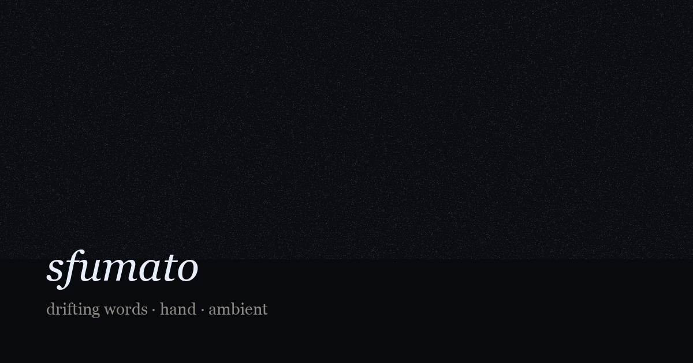

# sfumato

**Interactive browser artwork (2026)** — blurred webcam, hand-tracked words, generative ambient, fleeting lines of meaning.

[**Live demo**](https://illiaGoncharov.github.io/sfumato/) · Chrome or Arc on desktop · camera permission required



## About

*sfumato* applies the Renaissance soft-focus idea to attention itself: the figure dissolves into a dim haze while peripheral sensations—architecture, texture, light, sound—float as words in [OKLCH](https://oklch.com/) color space. An open hand lets them drift; a closed fist holds three nearby words in balance; release triggers a brief burst when color and motion align. The moment a line “forms” is accidental, not authored—closer to memory than manifesto.

All vision runs **on your device**. The camera stream is not uploaded; MediaPipe Hand Landmarker executes locally via WebAssembly.

## Sound

Generative ambient built with [Tone.js](https://tonejs.github.io/) (MIT), in the spirit of the Alva Noto × Ryuichi Sakamoto Raster-Noton series (*Vrioon*, *Insen*, *Revep*, *Summvs*): sparse dry clicks, long quiet tones, lots of space. Hand density and height modulate a low drone; a fist-held line triggers a soft chord; release adds a click and reverb swell. **Start** unlocks audio; **M** mutes.

Tune the palette separately: open [`dev/audio-spike.html`](dev/audio-spike.html) locally.

## Your words

- **N** — quick add: pick a sense (sound, smell, light…) and type a short detail; the word appears in the scene immediately.
- **E** — full library: list, starter packs (RU / EN), advanced `category / detail` textarea.
- Data is stored in **localStorage** by default.
- Optional **Supabase** sync (personal library only, RLS): copy [`config.example.js`](config.example.js) → `config.js`, run [`supabase/schema.sql`](supabase/schema.sql), enable anonymous auth. Link email in the words modal to move the same library across devices.

## Controls

| Input | Action |
|--------|--------|
| **Start** | Privacy + sound unlock |
| **C** | Toggle webcam |
| **V** | Toggle 9:16 / 16:9 canvas |
| **H** | Hide UI (clean view) |
| **M** | Mute sound |
| **N** | Add a sensation |
| **E** | Edit word library |
| **Mouse** | Hold / release mimics fist (when camera off) |

On macOS, turn off **Portrait** and **Background** in the camera menu—they break hand tracking.

## Stack

Vanilla JS · Canvas 2D · MediaPipe · Tone.js · culori · d3-delaunay · optional Supabase · GitHub Pages

## Layout

| Path | Purpose |
|------|---------|
| `index.html` | Live demo (GitHub Pages root) |
| `js/` | App modules (`hands`, `audio`, `words-store`) |
| `vendor/` | MediaPipe, Tone.js, culori, d3-delaunay |
| `dev/` | Local spikes (`spike.html`, `audio-spike.html`) — not linked from demo |
| `docs/` | `BACKLOG.md`, `CURATORIAL.md` (not deployed) |
| `supabase/` | SQL schema + setup notes |

## Run locally

```bash
git clone https://github.com/illiaGoncharov/sfumato.git
cd sfumato
./setup.sh   # if vendor/ is incomplete
python3 -m http.server 8000
# open http://localhost:8000
```

## Author

[Illia Goncharov](https://github.com/illiaGoncharov) — creative technologist
